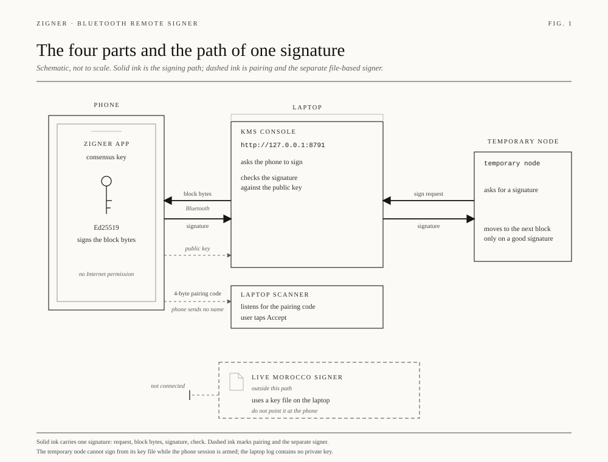
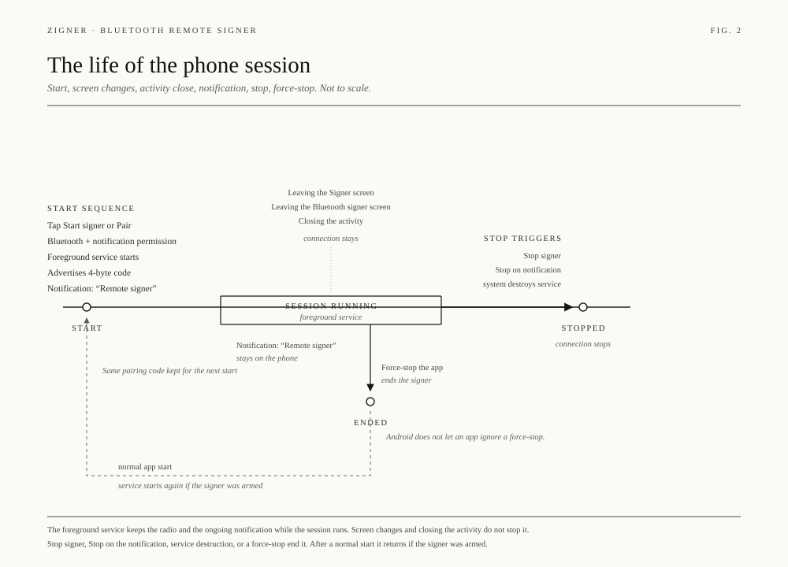
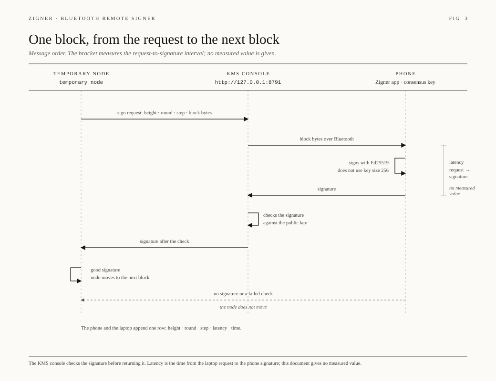
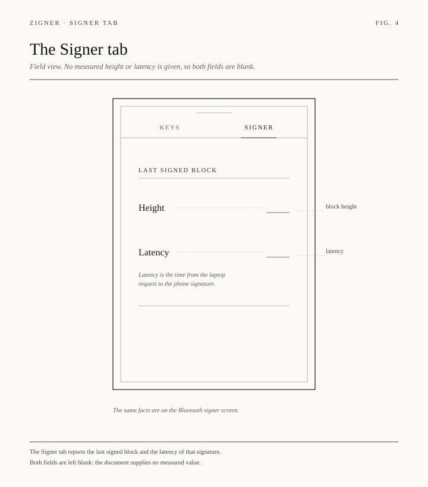

# zcinti

zcinti is the Bluetooth signer between a phone and the KMS console.
The phone holds the consensus key.
The laptop asks the phone to sign.
The console dials the temporary node configured with `--node` and `--dial`.
The live Morocco signer is a different process. Do not point it at zcinti.

## Three steps

1. The phone creates the consensus key. That is the validator key.
   A laptop file is not the validator key, and a container does not receive it.
   The KMS page does not show that seed.
2. The phone advertises a pairing code.
   You accept that code on the zcinti page.
   Reject drops the code.
   An accepted code stays accepted until you reject it or stop the scanner.
3. Takeoff generates the ephemeral account in this process.
   The granter is the Terp account on the phone. Bluetooth carries that address and the page fills it in.
   The offline granter signs one step: authz for create-validator, authz for revoke, authz for revoke-allowance, and a feegrant.
   The messages are `cosmossdk.io/api`, the proto API terp-core pins.
   After that grant is on the node, this account broadcasts `MsgExec` of create-validator, then `MsgExec` of the revoke.
   The consensus key stays on the phone. This console does not hold the granter key.

## What the page measures

Sign round trip is the time from the laptop request to the phone signature.
Block interval is the time from one committed block to the next.
Since last block is the age of the latest committed block.
Health is up only when a signature arrived in the last 20 seconds and the node answers.
The session line says live only while the GATT link is up. An accepted pairing code with the phone radio off stays waiting.
A laptop Bluetooth device list entry is not this session.

## Flows

## Where the same design is written

The phone copy is in the Zigner Signer tab.
The transaction page is cw-orch-kms.
The phone spec is `docs/bluetooth-remote-signer.md` in the Zigner repo.
